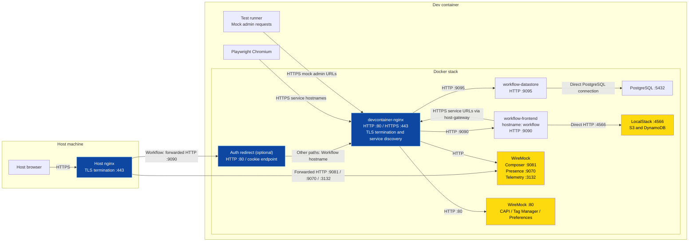

# End-to-end tests

It contains the browser-based, end-to-end (e2e) test suite for
workflow-frontend. Tests are written as Cucumber/Gherkin `.feature` files and
run with [Playwright](https://playwright.dev/) via
[`playwright-bdd`](https://github.com/vitalets/playwright-bdd).

It builds a self-contained local stack in Docker to the
workflow-frontend service and the workflow datastore backend with a number of
of mocked upstream services. The whole end to end tests can run within a machine so
that it can be included as part of our CI workflow later.

## Local stack

The local stack uses Testcontainers to build and run the frontend, Datastore,
PostgreSQL, and mocked dependencies in Docker. WireMock serves the upstream
HTTP APIs. LocalStack provides both S3 (PanDomain settings and the permissions
cache) and DynamoDB (seeded editorial support data).

Inside the dev container, `devcontainer-nginx` is the reverse proxy for the
application and mock service hostnames under `*.local.dev-gutools.co.uk`. It
discovers containers through the Docker socket and uses their
`devcontainer.hostname` labels to generate routes. WireMock containers also
advertise their HTTP listener through `devcontainer.application.port`.
The proxy publishes ports 80 and 443, terminates TLS, and forwards requests to
the containers over HTTP. WireMock no longer serves HTTPS itself.

1. **Playwright Chromium -> devcontainer-nginx -> application and mocks.** Tests
   load `https://workflow.local.dev-gutools.co.uk` and call the mock APIs through
   their HTTPS hostnames. Mock admin requests also use the proxy. There are no
   per-mock Chromium `--host-resolver-rules`; hostname resolution must reach the
   proxy. Playwright uses `ignoreHTTPSErrors` for the local certificates.

2. **Frontend -> devcontainer-nginx -> Datastore and upstream APIs.** The
   frontend calls HTTPS service URLs, including
   `https://workflow-datastore.local.dev-gutools.co.uk/api`. Its configured
   `host-gateway` entries direct these requests to the proxy's published ports.
   The application containers trust the local CA as described below.
   PostgreSQL and LocalStack remain direct Docker-network dependencies, not
   HTTP services routed through nginx.

3. **Host browser -> host nginx -> forwarded dev-container ports.** Host access
   retains the existing host nginx configuration and TLS termination. Workflow
   traffic goes to the optional auth-redirect container through forwarded port
   9090: `/cookie` sets the auth cookie, and other paths proxy to Workflow's
   hostname through `devcontainer-nginx`. Host routes for Composer, Presence,
   and Telemetry use their existing forwarded HTTP ports (9081, 9070, and 3132).

The diagram shows request paths; service ports inside the Docker stack are
container ports unless an edge explicitly says "forwarded".



## Prerequisites

- **Docker** — must be installed and running. The stack is built and run as
  containers via [testcontainers](https://testcontainers.com/).
- **Git SSH access to `guardian/workflow`** — the Datastore backend is checked
  out and built from the [guardian/workflow](https://github.com/guardian/workflow)
  repository. The test setup clones it automatically into
  `e2e-tests/target/workflow-backend/` (see [setup/checkout-datastore](setup/checkout-datastore)).
- **Git SSH access to `aug24/devcontainer-nginx`** - the stack commands check
  out the proxy into `e2e-tests/target/devcontainer-nginx/` and build its Dockerfile
  before starting it. Set `DEVCONTAINER_NGINX_DIR` to build from another checkout.
- **Proxy ports and certificates** - the stack reserves container name
  `devcontainer-nginx` and host ports 80 and 443. Remove any existing container
  with that name before starting the stack. Certificates are mounted read-only
  from `CERTS_DIR` (default: `certs/` in the nginx checkout), and the local CA
  from `$HOME/.local/share/mkcert`. Relative `CERTS_DIR` paths resolve against
  the nginx checkout; both nginx and process logs use its `logs/` directory.
  Container configuration is encoded in the setup code, not loaded from Compose
  at runtime.

The frontend and datastore mount only `$HOME/.local/share/mkcert/rootCA.pem`
read-only and import it into their mise-selected JDK's default truststore before
starting. Existing trusted certificates are preserved; the CA private key is not
mounted into either application container. Recreate the stack to pick up this
startup configuration. The public CA certificate must exist before startup.

The build tools, including mise, are installed when the devcontainer is built.
Its post-create hook runs `mise run setup`, including `setup:e2e`, to install
the e2e dependencies and Playwright Chromium automatically.

## Running the tests

The dependencies in the e2e-tests and the Playwright should have been installed after the devcontainer is built.

Use `mise run test`. You man run it from any directory within the repository. The e2e tasks
set their working directory to `e2e-tests/` automatically.

| Command | Purpose |
| --- | --- |
| `mise run dev:local` | Start a reusable Docker stack and authenticated browser |
| `mise run debug` | Start the shared stack with Docker build debug logging |
| `mise run test` | Generate BDD tests and run Playwright, starting or reusing the stack |
| `mise run test:ui` | Run the Playwright UI on port 9099 |
| `mise run test:report` | Serve the Playwright HTML report on port 9098 |

The equivalent Yarn commands below remain available.
Run these Yarn commands from the `e2e-tests/` folder.

```bash
yarn test
```

This generates the BDD test files (`bddgen`) from the feature files, ensures 
the Datastore backend is
checked out, builds the stack, and runs the test suite in headless mode.

### How the frontend is run

The dependency services (datastore, LocalStack, DynamoDB and the mocked upstream
APIs) all run as containers, and so does the workflow-frontend app itself. The
app is built and run as a container, mounting the sources live so `sbt run` +
`yarn build-dev` (webpack watch) reload edits to Scala or frontend assets
without rebuilding the image.


### Use host's browser to access Playwright UI

Headed mode is not supported in dev container, but you can run this command to
expose a port for a browser to access its Playwright UI.

```bash
yarn test:ui
```

The Playwright UI can be accessed via `http://localhost:9099/` on the host system.

The mise equivalent is `mise run test:ui`, which runs independently of
`dev:local`. To reuse a long-running stack, start `mise run dev:local` in a separate
terminal first and wait for the stack to be ready.

### Fast test loop with a shared stack

Building the stack on every run is slow. When iterating on tests,
start a long-running stack once and let subsequent test runs reuse it:

```bash
# Terminal 1 — boot the stack and leave it running (opens an authenticated browser)
yarn dev:local

# Terminal 2 — run tests repeatedly against the already-running stack
yarn test
```

The shared stack writes its connection details to a gitignored file that
`global-setup.ts` picks up; when present, the test run skips building containers.
Press `Ctrl+C` in terminal 1 to tear the stack down.

### Use host's browser to access Workflow frontend against the stack

After the long-running stack has started, we can access the Workflow frontend directly
from a browser on the host.

In the dev container, run:

```bash
# boot the stack
yarn dev:local
```

On the host, open this link `https://workflow.local.dev-gutools.co.uk/cookie` to load
the authentication cooke and then get redirected to the Workflow dashboard page.

### Viewing the report

After a run, open the HTML report (traces, videos and screenshots for failed
scenarios are attached):

```bash
yarn test:report
```

Raw artifacts are written to `e2e-tests/target/test-results/` and the report to
`e2e-tests/target/playwright-report/` (both gitignored). Traces/videos/screenshots are
captured on first retry and on failure — see `use` in
[playwright.config.ts](playwright.config.ts).

The test report is served via port 9098 which is mapped to the same port number
of the host. So you can open it by `http://localhost:9098` on your host directly.

## Folder structure

```
e2e/
├── features/          # Gherkin .feature files (one per behaviour area)
├── steps/             # Step definitions + Playwright fixtures wiring features to code
│   ├── fixtures.ts    # Shared test fixtures (stack connection, signIn, mocks, world)
│   └── shared/        # Network-level mocks (presence, telemetry, composer)
├── setup/             # Stack lifecycle + auth helpers (not test steps)
│   ├── stackContainers.ts  # Builds/starts/stops the Docker stack via testcontainers
│   ├── sharedStack.ts      # Reuse a long-running stack across runs
│   ├── panDomainCookie.ts  # Signs pan-domain auth cookies for test roles
│   ├── panDomainKeys.ts    # Generates the pan-domain signing keypair
│   ├── run-local-stack.ts  # Boots a shared long-running stack for `yarn dev:local`
│   └── checkout-datastore  # Clones/updates guardian/workflow backend
├── images/            # Dockerfiles and entrypoint scripts for each container in the stack
├── fixtures/          # Test data and config seeded into the stack
│   ├── conf/          # workflow-frontend + backend config for the local stack
│   ├── db/            # Postgres seed CSVs (sections, desks, stubs…)
│   ├── dynamodb/      # DynamoDB seed data (e.g. editorial support)
│   ├── permissions/   # Permission cache fixture (grants/denies workflow_access)
│   ├── pan-domain-settings/  # Pan-domain auth settings
│   ├── capi/                 # WireMock stubs for CAPI preview
│   ├── composer/             # WireMock stubs for the Composer API
│   ├── preferences/          # WireMock stubs for the Preferences service
│   ├── presence/             # WireMock stub for the presence client library
│   ├── tagmanager/           # WireMock stubs for Tag Manager
│   ├── telemetry/            # WireMock stubs for user telemetry
├── global-setup.ts    # Playwright global setup: start/reuse stack, write connection file
├── playwright.config.ts
├── mise.toml          # Pinned Node.js version
└── package.json       # Scripts and dev dependencies
```

## How a test run fits together

1. **`global-setup.ts`** starts the stack (or reuses a shared one) and writes its
   base URL and pan-domain signing key to `target/tmp/e2e-active-stack.json`.
2. **`steps/fixtures.ts`** reads that file to point every test at the stack,
   provides a `signIn` helper (pan-domain cookie), a per-scenario `world`
   scratch space, and mock objects (`presence`, `telemetry`, `composerMock`).
3. **`bddgen`** turns the `.feature` files into runnable Playwright tests using
   the step definitions in `steps/`.
4. Playwright runs the scenarios against Chromium.

## Writing tests

- **`.feature` files** follow the workflow-frontend evidence-annotated Gherkin
  conventions. See
  [.github/instructions/feature-files.instructions.md](../.github/instructions/feature-files.instructions.md)
  and the `feature-file-from-templates` skill for authoring guidance.
- **Step definitions** live in `steps/*.steps.ts` and are wired to Playwright
  via `Given`/`When`/`Then` exported from `steps/fixtures.ts`. See the
  [`feature-file-step-definitions`](../.github/skills/feature-file-step-definitions/SKILL.md) 
  skill for how to add missing steps.
- **Auth**: use the `signIn` fixture. Roles map to emails in
  `setup/panDomainCookie.ts`, which must match entries in
  `fixtures/permissions/permissions.json`.
- **Mocking**: upstream services inside the stack are seeded via WireMock
  fixtures.
